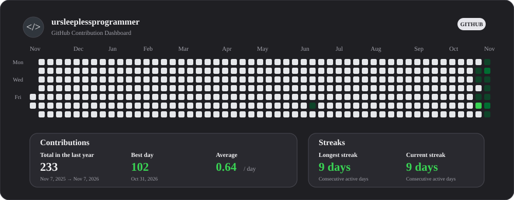

# Hi, I'm ursleeplessprogrammer 👋

  

  **AI & Machine Learning · Software Development · IT Operations**
  

   

  
  

---

  

 

  
  

---

## Tech Stack

  
 
    
👨‍💻 Programming and Markup Languages

    

      
      
      
      
      
      
      
      
      
      
      
      
    

  

  

    
🧰 Frameworks and Libraries

      

        
        
        
        
        
        
        
        
        
        
        
        
        
        
        
    

  

 

   
🗄️Databases and Cloud Hosting

    

      
      
      
      
      
      
      
    

 

  

    
💻 AI & Machine Learning

    

      
      
      
      
    

  

  

  

    
🛠️ Tools, Platforms & IDE's

      

      
      
      
      
      
      
      
      
      
      
      
      
      
      
      
    

  

  

---

## Professional Experience

**IT Specialist — PT Bank Central Asia Tbk (BCA)**

Working in IT operations with responsibilities involving:

- Data Center monitoring systems and verification.
- Incident monitoring, response, and escalation.
- Coordination related to Data Center facilities.
- System notifications and operational monitoring.
- Continuous improvement through automation and process optimization.

---

## Featured Projects

A selection of projects covering artificial intelligence, machine learning, web development, and application development.

  
🧠 AI & Machine Learning Projects

  <table>
    <tr>
      <td width="50%" valign="top">
        <h3>🧠 Hate Speech Classification</h3>
        
Multi-label classification of Indonesian Twitter hate speech using neural networks and Semantic-Guided Modeling.

        
      </td>
      <td width="50%" valign="top">
        <h3>🤖 Auto Summary Bot</h3>
        
AI-powered Telegram bot that summarizes text, URLs, PDFs, and YouTube videos into concise insights.

        
      </td>
    </tr>
    <tr>
      <td width="50%" valign="top">
        <h3>🔍 AML Transaction Alert Prioritization</h3>
        
SAML-D based approach to prioritizing potentially suspicious banking transaction alerts.

        
      </td>
      <td width="50%" valign="top">
        <h3>📊 Incident Workload Forecasting</h3>
        
Machine learning project exploring incident workload forecasting for operational planning.

        
      </td>
    </tr>
    <tr>
      <td width="50%" valign="top">
        <h3>👁️ Multiple Object Tracking</h3>
        
Computer vision implementation combining DeepSORT and YOLOv3 for object detection and tracking.

        
      </td>
      <td width="50%" valign="top">
        <h3>💳 Bank Transaction Anomaly Detection</h3>
        
Machine learning experimentation focused on identifying unusual patterns in financial transaction data.

        
      </td>
    </tr>
    <tr>
      <td width="50%" valign="top">
        <h3>🧪 AI Agent Reliability Lab</h3>
        
A modular Python project that tests how reliably an AI agent works.

        
      </td>
      <td width="50%" valign="top">
        <h3>📊 Customer Complaint Insights</h3>
        
Machine Learning experimentation that make uses of the CFPB’s current Consumer Complaint Database API.

        
      </td>
    </tr>
    <tr>
      <td width="50%" valign="top">
        <h3>🔎 Social Media Topic Scrapper</h3>
        
This is a Python project that analyzes social-media posts related to user-selected keywords or topics.

        
      </td>
      <td width="50%" valign="top">
        <h3>⚙️ Rule-Based Expert System</h3>
        
An expert system implementation exploring rule-based reasoning and decision-making.

        
      </td>
    </tr>
  </table>
  

  
🌐 Web & Application Development

  <table>
    <tr>
      <td width="50%" valign="top">
        <h3>🌐 Enrollment Website Project 2023–24</h3>
        
Website development project focused on enrollment and registration processes.

        
      </td>
      <td width="50%" valign="top">
        <h3>🚗 SeKO Car Rental Apps</h3>
        
Application development project for car rental management.

        
      </td>
    </tr>
    <tr>
      <td width="50%" valign="top">
        <h3>🎨 Computer Graphics using C#</h3>
        
Computer graphics implementation using C# and OpenTK.

        
      </td>
      <td width="50%" valign="top">
        <h3>💍 Wedding Planner Dashboard</h3>
        
This project utilizes Google Apps Script to create and format a wedding-planning spreadsheet.

        
      </td>
    </tr>
  </table>

---

## Knowledge & Learning

A growing collection of technical documentation, guides, and personal notes based on research, experimentation, and continuous learning.

  
<b>Artificial Intelligence & AI Agents</b>

  | Topic | Repository |
  |:--|:--|
  | AI in General | [Explore →](https://github.com/ursleeplessprogrammer/AI-in-General) |
  | AI Agent Roadmap | [Explore →](https://github.com/ursleeplessprogrammer/AI-Agent-Roadmap) |
  | AI Agent Deployment | [Explore →](https://github.com/ursleeplessprogrammer/AI-Agent-Deployment) |
  | AI Agent Handoffs in Multi-Agent Systems | [Explore →](https://github.com/ursleeplessprogrammer/AI-Agent-Handoffs-in-Multi-Agent-System) |
  | AI Agent Family - Claude | [Explore →](https://github.com/ursleeplessprogrammer/AI-Agent-Family-Claude) |
  | AI Agent Family - OpenClaw | [Explore →](https://github.com/ursleeplessprogrammer/AI-Agent-Family-OpenClaw) |
  | AI Agent Family - Hermes | [Explore →](https://github.com/ursleeplessprogrammer/AI-Agent-Family-Hermes) |

  
<b>Machine Learning</b>

  | Topic | Repository |
  |:--|:--|
  | Machine Learning in General | [Explore →](https://github.com/ursleeplessprogrammer/Machine-Learning-in-General) |
  | Preparation and Foundations | [Explore →](https://github.com/ursleeplessprogrammer/Machine-Learning---Preparation) |
  | Linear and Logistic Regression | [Explore →](https://github.com/ursleeplessprogrammer/Machine-Learning---Linear-Logistic-Regression) |
  | Decision Trees and Random Forests | [Explore →](https://github.com/ursleeplessprogrammer/Machine-Learning---Decision-Trees-and-Random-Forests) |
  | Gradient Boosting | [Explore →](https://github.com/ursleeplessprogrammer/Machine-Learning---Gradient-Boosting) |
  | Support Vector Machine | [Explore →](https://github.com/ursleeplessprogrammer/Machine-Learning---Support-Vector-Machine) |
  | K-Nearest Neighbors | [Explore →](https://github.com/ursleeplessprogrammer/Machine-Learning---KNNeighbors) |
  | Naive Bayes | [Explore →](https://github.com/ursleeplessprogrammer/Machine-Learning---Naive-Bayes) |
  | Clustering: K-Means and DBSCAN | [Explore →](https://github.com/ursleeplessprogrammer/Machine-Learning---Clustering) |
  | Dimensionality Reduction: PCA | [Explore →](https://github.com/ursleeplessprogrammer/Machine-Learning---Dimensionality-Reduction-with-PCA) |
  | Embedding: FastText | [Explore →](https://github.com/ursleeplessprogrammer/ML-Embedding-FastText) |
  | Embedding: GloVe | [Explore →](https://github.com/ursleeplessprogrammer/ML-Embedding-GLoVe) |
  | Embedding: Word2Vec | [Explore →](https://github.com/ursleeplessprogrammer/ML-Embedding-Word2Vec) |

  
<b>Web & Application Development</b>

  | Topic | Repository |
  |:--|:--|
  | Flask in General | [Explore →](https://github.com/ursleeplessprogrammer/Flask-in-General) |
  | Laravel in General | [Explore →](https://github.com/ursleeplessprogrammer/Laravel-in-General) |
  | Spring Boot in General | [Explore →](https://github.com/ursleeplessprogrammer/SpringBoot-in-General) |

---

## Let's Connect

  

    

  *They may recreate the shape of what I make, but the soul that gave it form remains my own.*
  — ursleeplessprogrammer

